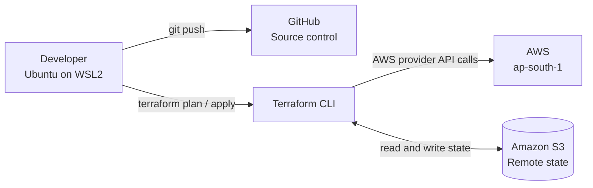
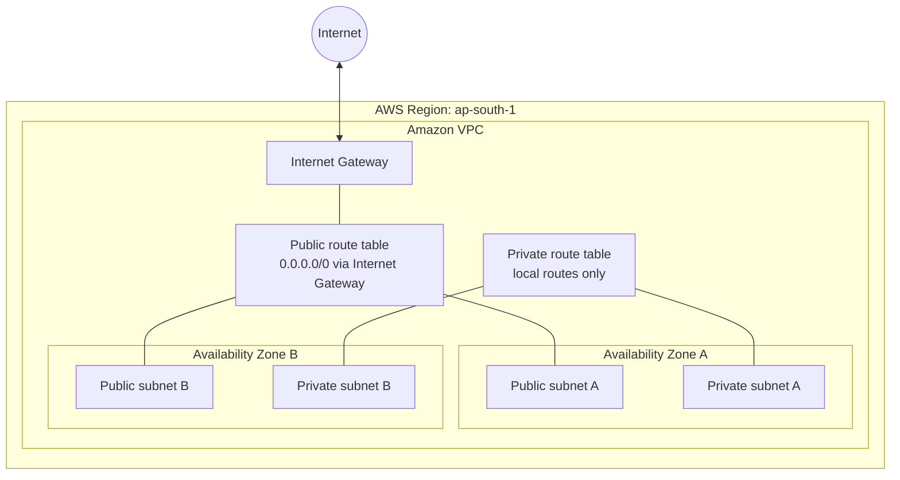

<div align="center">

# AWS Terraform VPC Infrastructure

**Automating AWS network infrastructure with Terraform (Infrastructure as Code)**


</div>

---

## Overview

This project provisions and manages AWS networking infrastructure with **Terraform**. A single `terraform apply` builds a Virtual Private Cloud (VPC) with public and private subnets, an Internet Gateway, route tables and route table associations, and `terraform destroy` removes it again.

Terraform state is stored remotely in an **Amazon S3 bucket**, and all configuration is version-controlled with **Git and GitHub**.

It is the networking foundation for later stages of the project (load balancer, Auto Scaling, containers and CI/CD, see the [Roadmap](#roadmap)).

---

## Architecture

### Workflow

How a change travels from the developer's machine to AWS:



### Network design

The infrastructure Terraform creates inside AWS:



### Architecture notes

- The **VPC** is an isolated virtual network inside AWS.
- **Public subnets** are associated with a route table that sends internet-bound traffic to the Internet Gateway.
- **Private subnets** use a separate route table with local routes only, so they are not directly reachable from the internet.
- **Amazon S3** stores the Terraform remote state.
- The diagrams show only what this repository deploys. No NAT Gateway, EC2 instances, load balancer or other services are configured yet.

---

## Resources Created

| Terraform resource type | Purpose |
|---|---|
| `aws_vpc` | The isolated virtual network |
| `aws_subnet` | Public and private subnets across availability zones |
| `aws_internet_gateway` | Connects the VPC to the internet |
| `aws_route_table` | Separate public and private route tables |
| `aws_route` | Default route from the public route table to the Internet Gateway |
| `aws_route_table_association` | Links each subnet to the correct route table |

---

## Technology Stack

| Technology | Purpose |
|---|---|
| Terraform | Infrastructure as Code and resource provisioning |
| Amazon Web Services | Cloud platform |
| Amazon VPC | Isolated virtual network, subnets, Internet Gateway, route tables |
| Amazon S3 | Remote Terraform state storage |
| AWS CLI | Credentials, identity checks and resource inspection |
| Git and GitHub | Version control and source hosting |
| Ubuntu on WSL2 | Linux development environment |
| HCL and Markdown | Infrastructure configuration and documentation |

---

## Project Structure

```text
aws-terraform-infra/
├── main.tf               # Core resources
├── provider.tf           # AWS provider configuration
├── versions.tf           # Terraform and provider version constraints, S3 backend
├── vpc.tf                # VPC definition
├── subnets.tf            # Public and private subnets
├── networking.tf         # Internet Gateway, route tables, associations
├── .gitignore            # Keeps state, plans and local files out of Git
├── .terraform.lock.hcl   # Provider version lock (commit this file)
└── README.md
```

---

## Prerequisites

- An AWS account with IAM permissions to manage VPC resources and read/write the state bucket
- [Terraform](https://developer.hashicorp.com/terraform/install) installed (version 1.10 or newer if you use native S3 state locking)
- [AWS CLI](https://docs.aws.amazon.com/cli/latest/userguide/getting-started-install.html) installed and configured
- Git installed
- Ubuntu/Linux or WSL2
- An existing S3 bucket for remote state (see [Remote State Management](#remote-state-management))

---

## Getting Started

### 1. Clone the repository

```bash
git clone https://github.com/srushtirevoor99-beep/aws-terraform-infra.git
cd aws-terraform-infra
```

### 2. Configure AWS credentials

```bash
aws configure
```

Use the region configured for this project (`ap-south-1`), then verify your identity:

```bash
aws sts get-caller-identity
```

### 3. Initialize Terraform

```bash
terraform init
```

This downloads the AWS provider and connects Terraform to the S3 backend.

### 4. Format and validate

```bash
terraform fmt -recursive
terraform validate
```

### 5. Review the execution plan

```bash
terraform plan
```

Read the plan carefully. `+` means create, `~` means change in place, and `-` means destroy.

### 6. Deploy

```bash
terraform apply
```

Type `yes` only when the proposed changes are expected.

### 7. Verify

```bash
terraform state list
aws ec2 describe-subnets --region ap-south-1 \
  --query "Subnets[].{ID:SubnetId,CIDR:CidrBlock,AZ:AvailabilityZone}" --output table
```

You can also check the VPC dashboard in the AWS Console.

### 8. Clean up

```bash
terraform destroy
```

Destroy resources when you are done experimenting. The state bucket is kept separate and is not removed by this command.

---

## Remote State Management

Terraform state maps your configuration to real AWS resources. This project stores it in an **Amazon S3 backend** so it is durable, versioned and not tied to one machine.

Example backend configuration (replace the placeholders):

```hcl
terraform {
  required_version = ">= 1.10"

  backend "s3" {
    bucket       = "YOUR-STATE-BUCKET-NAME"
    key          = "infra/terraform.tfstate"
    region       = "ap-south-1"
    encrypt      = true
    use_lockfile = true   # native S3 locking, Terraform 1.10+
  }
}
```

The state bucket is created once, outside Terraform, with:

- **Versioning enabled**, so earlier state versions can be recovered
- **Public access blocked** on all four settings
- **Encryption** enabled for stored state

> **Important:** Terraform state can contain sensitive values. Restrict access to the bucket, and never commit `*.tfstate` files or saved plan files to Git.

---

## Security Best Practices

- Apply least-privilege IAM permissions.
- Never commit AWS access keys, secret keys or credentials.
- Restrict access to the Terraform state bucket.
- Keep `.terraform/`, local state files and saved plans out of Git via `.gitignore`.
- Review every `terraform plan` before applying.
- Do not add internet-facing resources without suitable security controls (security groups, least-open rules).
- Monitor AWS usage and delete resources you no longer need.

---

## Cost Notes

The VPC, subnets, Internet Gateway and route tables created here have no hourly charge. The S3 state bucket costs very little at this scale. Charges would come from services added later, such as NAT Gateways, load balancers and EC2 instances, none of which are deployed by this repository. Set an AWS Budgets alert and run `terraform destroy` after each practice session.

---

## Learning Outcomes

- Infrastructure as Code with Terraform (resources, references, state, plan and apply)
- AWS VPC and subnet design with public and private routing
- Remote state management in Amazon S3
- AWS CLI usage and IAM permissions
- Git and GitHub workflow and infrastructure documentation

---

## Roadmap

- [ ] Add security groups, an Application Load Balancer and an Auto Scaling Group
- [ ] Containerize a sample app and deploy it through Amazon ECR
- [ ] Add GitHub Actions for `fmt`, `validate` and `plan` on pull requests, with `apply` on merge using OIDC
- [ ] Refactor into reusable Terraform modules
- [ ] Add automated security scanning (tfsec or Checkov)
- [ ] Add monitoring and cleanup automation

---

## Author

**Srushti Revoor**

GitHub: [srushtirevoor99-beep](https://github.com/srushtirevoor99-beep)

---

<div align="center">

*Built as a hands-on cloud engineering project focused on AWS networking, Terraform and Infrastructure as Code.*

</div>
