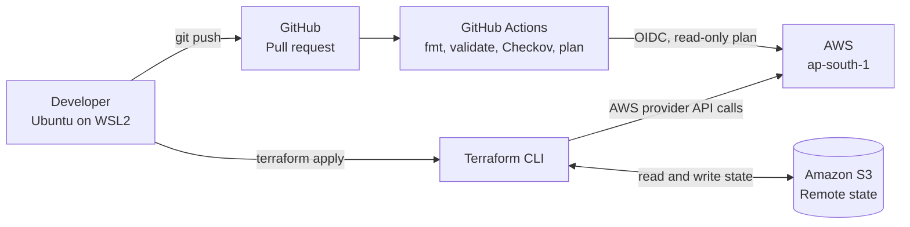
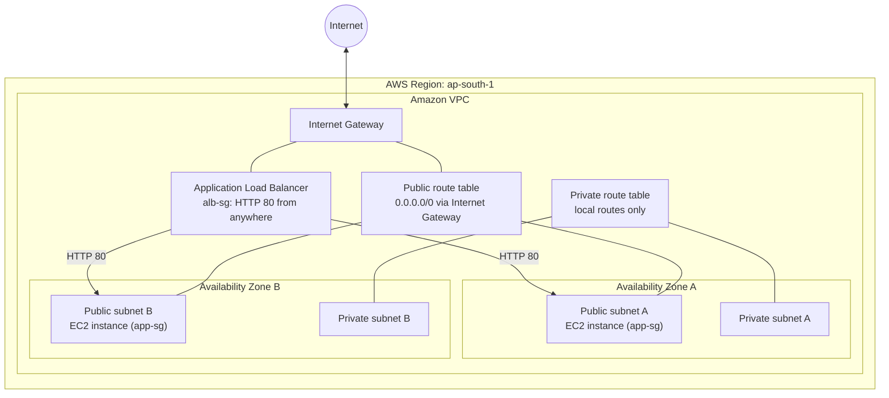
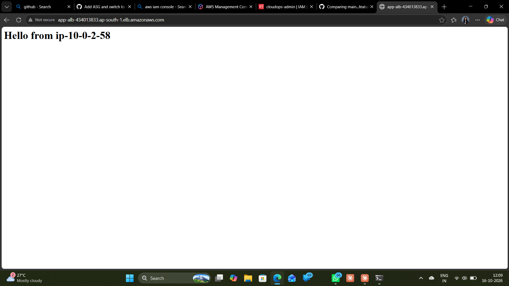
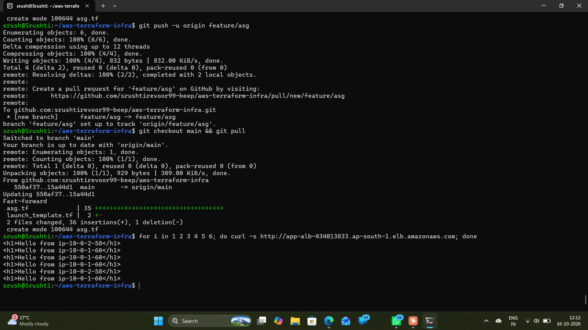
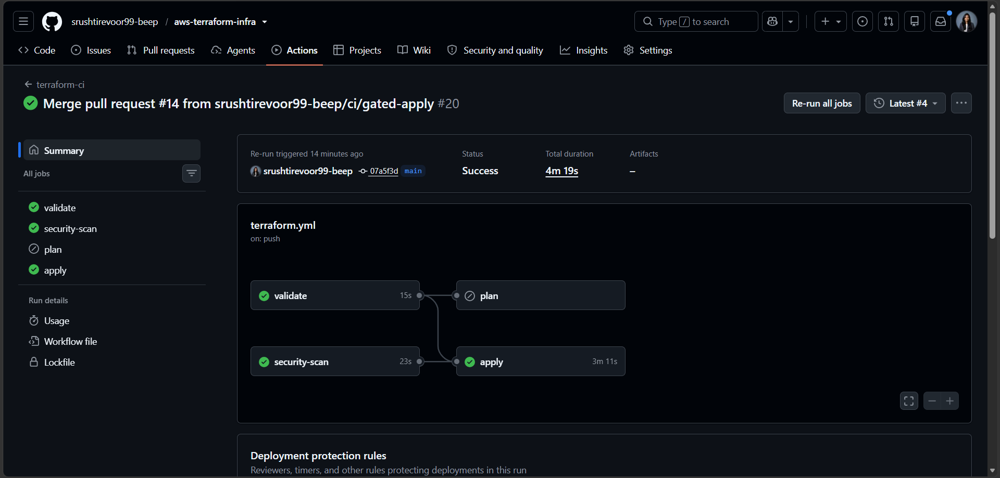

<div align="center">

# AWS Terraform Infrastructure: VPC, ALB and Auto Scaling

**A load-balanced, auto-scaling web tier on AWS, built with Terraform and checked by a CI pipeline**


</div>

---

## Overview

This project provisions a small, production-style web tier on AWS with **Terraform**. A single `terraform apply` builds:

- a **VPC** with public and private subnets across two availability zones
- an **Application Load Balancer** that accepts HTTP from the internet
- an **Auto Scaling Group** of Ubuntu instances that serve a page through nginx in Docker
- **security groups** so the instances only accept traffic from the load balancer

`terraform destroy` removes everything again.

Terraform state is stored remotely in an **Amazon S3 bucket**. Every change goes through a pull request, where **GitHub Actions** runs format, validate, a **Checkov** security scan and a `terraform plan` using **GitHub OIDC** (no stored AWS keys).

---

## Architecture

### Workflow

How a change travels from the developer's machine to AWS:



### Network design

The infrastructure Terraform creates inside AWS:



### Architecture notes

- The **VPC** is an isolated virtual network. Its default security group is locked down (no rules).
- **Public subnets** route internet-bound traffic through the Internet Gateway. The ALB and the instances live here.
- **Private subnets** have a separate route table with local routes only. Nothing runs in them yet.
- The **ALB** accepts HTTP on port 80 and forwards to a target group with a health check on `/`.
- The **app security group** accepts HTTP **only from the ALB security group**, not from the internet.
- The **Auto Scaling Group** keeps 2 to 4 `t3.micro` instances running across both zones and scales on average CPU (target 50%).
- Instances run Ubuntu 22.04, require **IMDSv2**, install Docker on boot and serve a page from `nginx`.
- A **CloudWatch alarm** watches the target group and goes into alarm when an instance has failed health checks for three minutes in a row. It can notify an SNS topic through the `alarm_actions` variable.
- Instances sit in public subnets to avoid the cost of a NAT Gateway. A production setup would use private subnets with NAT.

---

## Resources Created

| Area | Terraform resource types | Purpose |
|---|---|---|
| Network | `aws_vpc`, `aws_subnet`, `aws_internet_gateway`, `aws_route_table`, `aws_route`, `aws_route_table_association`, `aws_default_security_group` | VPC, four subnets, internet access, routing, locked-down default security group |
| Security groups | `aws_security_group`, `aws_vpc_security_group_ingress_rule`, `aws_vpc_security_group_egress_rule` | ALB and app security groups with explicit rules |
| Load balancer | `aws_lb`, `aws_lb_target_group`, `aws_lb_listener` | Public HTTP entry point and health-checked target group |
| Compute | `aws_launch_template`, `aws_autoscaling_group`, `aws_autoscaling_policy`, `aws_ami` (data) | Self-healing, CPU-scaled instances from the latest Ubuntu 22.04 AMI |
| Monitoring | `aws_cloudwatch_metric_alarm` | Alarm on unhealthy targets behind the load balancer |

---

## Technology Stack

| Technology | Purpose |
|---|---|
| Terraform | Infrastructure as Code and resource provisioning |
| Amazon VPC, ALB, EC2 Auto Scaling | Network, load balancing and compute |
| Amazon S3 | Remote Terraform state storage |
| GitHub Actions | CI: format, validate, security scan and plan on every pull request |
| GitHub OIDC and AWS IAM | Short-lived credentials for CI, no access keys stored in GitHub |
| Checkov | Static security scanning of the Terraform code |
| TFLint | Linting for Terraform and AWS-specific mistakes (documented variables and outputs, pinned providers) |
| `terraform test` | Plan-time unit tests for every module, using a mocked AWS provider |
| Amazon CloudWatch | Alarm on unhealthy load balancer targets |
| Docker and nginx | Sample app served by each instance |
| AWS CLI | Credentials, identity checks and resource inspection |
| Ubuntu on WSL2 | Linux development environment |

---

## Project Structure

```text
aws-terraform-infra/
├── .github/workflows/
│   └── terraform.yml       # CI: validate, lint, test, security-scan, plan, apply
├── modules/
│   ├── vpc/                # VPC, subnets, Internet Gateway, route tables
│   ├── alb/                # Load balancer, target group, listener, health alarm
│   └── asg/                # Launch template, Auto Scaling Group, scaling policy
│                           # (every module has versions.tf and tests/*.tftest.hcl)
├── docs/                   # Screenshots and notes
├── main.tf                 # Wires the three modules together
├── security_groups.tf      # ALB and app security groups and their rules
├── variables.tf            # aws_region and alarm_actions
├── outputs.tf              # Prints the ALB DNS name
├── provider.tf             # AWS provider configuration
├── versions.tf             # Terraform and provider versions, S3 backend
├── terraform.tfvars.example # Example values (copy to terraform.tfvars)
├── .tflint.hcl             # TFLint configuration
├── .terraform.lock.hcl     # Provider version lock (commit this file)
├── .gitignore              # Keeps state, plans and local files out of Git
├── LICENSE
└── README.md
```

### Design notes

- **Why `security_groups.tf` is not a module:** the ALB group sends traffic to the app group and the app group accepts traffic from the ALB group. Each refers to the other, so they live next to the modules that consume them. Putting them inside the `alb` or `asg` module would create a circular dependency between the modules.
- **Why the lock file is committed:** it pins provider versions, so CI and every developer install exactly the same provider build.

---

## CI Pipeline

The workflow in `.github/workflows/terraform.yml` runs on every pull request and on every push to `main`.

| Job | What it does | When |
|---|---|---|
| `validate` | `terraform fmt -check -recursive`, `init -backend=false`, `validate` | Pull requests and `main` |
| `lint` | TFLint with the Terraform and AWS rulesets on the root and every module | Pull requests and `main` |
| `test` | `terraform test` for each module (`vpc`, `alb`, `asg`) in parallel, with a mocked AWS provider so no credentials are needed | Pull requests and `main` |
| `security-scan` | Runs Checkov on the Terraform code | Pull requests and `main` |
| `plan` | Assumes an AWS role through GitHub OIDC, then `terraform plan -lock=false` | Pull requests only, after `validate` passes |
| `apply` | Assumes a separate write role through OIDC, plans, then applies that exact plan | Pushes to `main` only, after `validate`, `lint`, `test` and `security-scan` pass and a reviewer approves the `production` environment |

Notes:

- The plan role is read-only, which is why the plan runs with `-lock=false` (a lock would need write access to the state bucket).
- Checkov is enforcing: any failed check fails the build and blocks the pull request. Findings that are accepted on purpose are skipped in code with a written reason.
- Accepted risks are documented in the code with `#checkov:skip=<ID>:<reason>` comments. Examples: HTTP-only listener (no domain or certificate), no WAF or access logging (cost), instances in public subnets (no NAT cost). Each skip has a reason next to it.
- `apply` runs only after a merge to `main` and only after manual approval of the `production` environment. It uses a separate IAM role that trusts only that environment, so pull requests and other branches can never deploy.

---

## Configuration and Testing

Inputs live in `variables.tf`:

| Variable | Default | Purpose |
|---|---|---|
| `aws_region` | `ap-south-1` | Region the infrastructure is created in |
| `alarm_actions` | `[]` | ARNs (for example an SNS topic) notified when the unhealthy-host alarm changes state |

Copy `terraform.tfvars.example` to `terraform.tfvars` to override them. The state bucket and CI role names are not variables, because the backend block cannot use variables.

Run the same checks as CI before you push:

```bash
terraform fmt -check -recursive
tflint --init && tflint --recursive
for m in vpc alb asg; do (cd modules/$m && terraform init -backend=false && terraform test); done
```

The module tests run at plan time against a mocked AWS provider. They check things that matter for security and reliability: IMDSv2 is required, subnets sit in different availability zones, the load balancer drops invalid headers, and the CPU target is 50%.

---

## Prerequisites

- An AWS account with IAM permissions to manage VPC, EC2, ELB and Auto Scaling resources and to read and write the state bucket
- [Terraform](https://developer.hashicorp.com/terraform/install) 1.10 or newer (native S3 state locking)
- [AWS CLI](https://docs.aws.amazon.com/cli/latest/userguide/getting-started-install.html) installed and configured
- Git installed
- Ubuntu/Linux or WSL2
- An existing S3 bucket for remote state (see [Remote State Management](#remote-state-management))

---

## Required Permissions

The Terraform deployment role must have the permissions required to create, update, describe, and delete the AWS resources defined in this project.

**CloudWatch alarms:** If the Terraform configuration manages CloudWatch alarms, the apply role needs the corresponding CloudWatch permissions, including the specific `cloudwatch:PutMetricAlarm`, `cloudwatch:DescribeAlarms`, and `cloudwatch:DeleteAlarms` actions required by the configuration.

Missing permissions can cause Terraform `AccessDenied` errors during `terraform plan` or `terraform apply`.

**Security best practice:** Follow least privilege. Grant only the actions and resource access required by the Terraform configuration. Review any additional permissions reported by AWS errors before updating the role's IAM policy.

---

## Getting Started

### 1. Clone the repository

```bash
git clone https://github.com/srushtirevoor99-beep/aws-terraform-infra.git
cd aws-terraform-infra
```

### 2. Configure AWS credentials

```bash
aws configure
```

Use the region configured for this project (`ap-south-1`), then verify your identity:

```bash
aws sts get-caller-identity
```

### 3. Point Terraform at your own state bucket

Edit the `backend "s3"` block in `versions.tf` and replace the bucket name with a bucket you own.

### 4. Initialize Terraform

```bash
terraform init
```

### 5. Format and validate

```bash
terraform fmt -recursive
terraform validate
```

### 6. Review the execution plan

```bash
terraform plan
```

Read the plan carefully. `+` means create, `~` means change in place, and `-` means destroy.

### 7. Deploy

```bash
terraform apply
```

Type `yes` only when the proposed changes are expected.

### 8. Verify

```bash
terraform output alb_dns_name
curl http://$(terraform output -raw alb_dns_name)
```

Instances take a couple of minutes to install Docker and pass health checks, so the first request may return a 503. Repeat the `curl` a few times: the hostname in the response alternates between the two instances.

### 9. Clean up

```bash
terraform destroy
```

Destroy resources when you are done experimenting. The state bucket is kept separate and is not removed by this command.

---

## Remote State Management

Terraform state maps your configuration to real AWS resources. This project stores it in an **Amazon S3 backend** so it is durable, versioned and not tied to one machine.

Backend configuration (see `versions.tf`):

```hcl
terraform {
  required_version = ">= 1.10.0"

  backend "s3" {
    bucket       = "YOUR-STATE-BUCKET-NAME"
    key          = "aws-terraform-infra/terraform.tfstate"
    region       = "ap-south-1"
    use_lockfile = true   # native S3 locking, Terraform 1.10+
  }
}
```

The state bucket is created once, outside Terraform, with:

- **Versioning enabled**, so earlier state versions can be recovered
- **Public access blocked** on all four settings
- **Encryption** enabled for stored state

> **Important:** Terraform state can contain sensitive values. Restrict access to the bucket, and never commit `*.tfstate` files or saved plan files to Git.

---

## Security Best Practices

- Apply least-privilege IAM permissions. CI uses a separate read-only role through OIDC.
- Never commit AWS access keys, secret keys or credentials.
- Restrict access to the Terraform state bucket.
- Keep `.terraform/`, local state files and saved plans out of Git via `.gitignore`.
- Review every `terraform plan` before applying.
- Instances accept traffic only from the load balancer, and require IMDSv2.
- Every accepted Checkov finding is skipped explicitly in code with a written reason.
- Monitor AWS usage and delete resources you no longer need.

### Known limitations (demo trade-offs)

- HTTP only: there is no domain or ACM certificate, so no HTTPS.
- No WAF and no ALB access logs (cost and scope).
- No VPC flow logs.
- Instances are in public subnets with public IPs instead of private subnets behind a NAT Gateway.
- The ALB has no deletion protection, so `terraform destroy` works.

---

## Demo

The Auto Scaling Group launched two instances across two availability zones.
Refreshing the load balancer URL alternates between them, which shows the ALB
distributing traffic.





### Gated deployment

Merging to `main` pauses the `apply` job until the `production` environment is approved.



---

## Cost Notes

The VPC, subnets, Internet Gateway, route tables and security groups have no hourly charge, and the S3 state bucket costs very little at this scale. The **Application Load Balancer** and the **EC2 instances** do cost money while they run, and the instances need public IPv4 addresses, which are also billed. Set an AWS Budgets alert and run `terraform destroy` after each practice session.

---

## Learning Outcomes

- Infrastructure as Code with Terraform (resources, modules, references, state, plan and apply)
- AWS VPC design with public and private routing
- Load balancing and Auto Scaling with security groups chained ALB to instances
- Remote state management in Amazon S3
- CI with GitHub Actions: fmt, validate, plan and security scanning
- Keyless AWS access from CI using GitHub OIDC
- Reading and triaging Checkov findings, and documenting accepted risks
- Linting Terraform with TFLint and writing plan-time unit tests with `terraform test` and a mocked provider
- Monitoring with a CloudWatch alarm on load balancer target health
- Gating deployments: a failed lint, test or scan blocks `apply`, and a reviewer must approve the `production` environment

---

## Author

**Srushti Revoor**

GitHub: [srushtirevoor99-beep](https://github.com/srushtirevoor99-beep)

---

<div align="center">

*Built as a hands-on cloud engineering project focused on AWS networking, load balancing, Terraform and Infrastructure as Code.*

</div>
